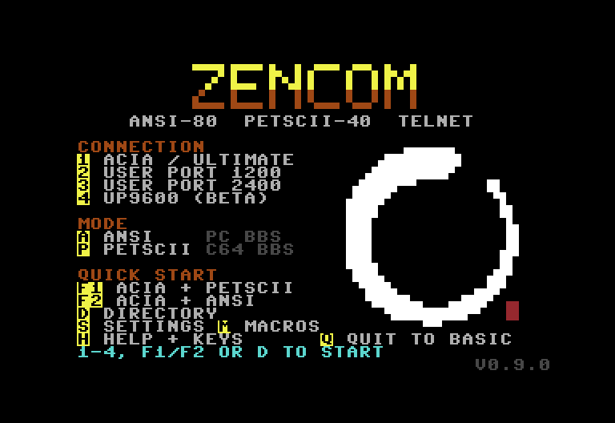
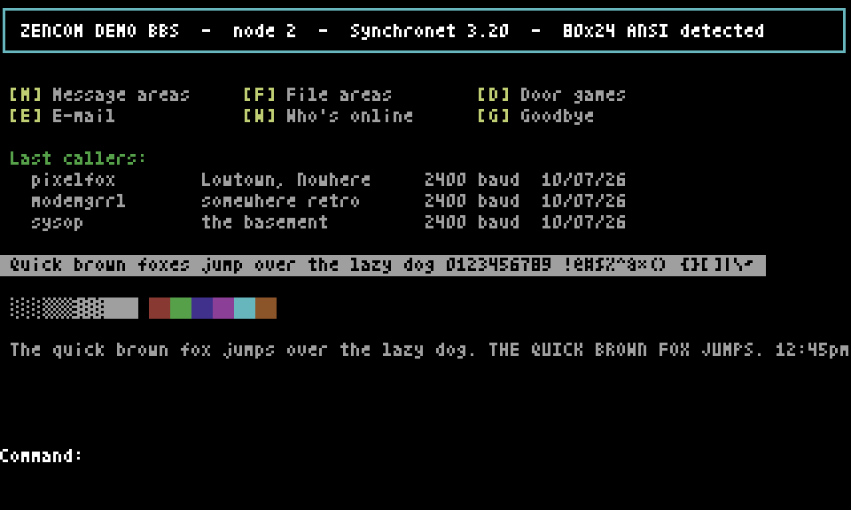

# ZenCom

A telnet/BBS terminal for the Commodore 64, written in 6502 assembly.

**ZenCom was built to make browsing and using BBSes as easy as possible,
especially if you have never used one before.** The screens say what each
key does, there is nothing to set up before the first call, and every
screen has a way back.

- **ANSI-80**: 80 columns by 24 rows on a hires bitmap, with ANSI/VT100
  cursor control, colour, CP437 line and block graphics, and telnet.
- **PETSCII-40**: the C64's own text screen, for Commodore boards.

Switch between the two at any time with F7.





ZenCom is in beta. **Tested** so far: a C64 Ultimate with its
SwiftLink-type modem emulation and its SoftIEC drive; the
Ultimate's cycle-exact 1541 emulation; and VICE (PAL and NTSC, SwiftLink,
true-drive 1541). Not yet tested on real 1541s, other drives, real modem
cartridges or a real NTSC machine. Reports are welcome: see *Contact*.

## What you need

- A Commodore 64 (PAL or NTSC) and a disk drive. ZenCom uses the KERNAL's
  ordinary disk access (and `CD` for folders), so a 1541, 1571, 1581,
  SD2IEC, Pi1541 or CMD drive should work; see above for what has been
  tested.
- A modem:
  - **SwiftLink-type** (6551 ACIA at $DE00, NMI): the modem emulation of
    an Ultimate (tested), or a SwiftLink or Turbo232-in-SwiftLink-mode
    cartridge (expected to work; not yet tested on real ones).
  - **User-port modem** (Wi-Fi modems and the like) through the KERNAL at
    1200 or 2400 baud. **Not yet tested on real hardware.** In VICE it lost
    characters at 1200 (VICE's emulation may be to blame: BASIC's own
    GET# lost them too), and the KERNAL's RS-232 is known to struggle at
    2400. Try 1200 first.
  - **UP9600** user-port modem at 9600 baud. **Beta: not yet tried on a
    real UP9600 modem.** Reports especially welcome.

## What's on the disk

| File | |
|---|---|
| ZENCOM | The program |
| ZENCOM.XFR | Its file transfers and menu screens (keep it with ZENCOM) |
| BBSLIST | A starter list of boards (D on the menu) |
| READER | Shows the three files below on screen |
| README | This manual |
| QUICKREF | One page to print |
| LICENCE | The MIT licence |
| ZENCOM.CFG | Your settings (S on the menu) |
| ZENCOM.MAC | Your macros (M on the menu) |
| ZENCOM.PWD | Your board logins (E in the directory) |

The last three start empty apart from a first line saying what they are.
ZenCom fills them in when you save; it skips lines starting with `#`.

To read README on the C64: `LOAD"READER",8` and `RUN`. Or type this in
(it shows the file a page at a time; press a key for the next page):

```
10 OPEN2,8,2,"README,S,R":POKE53272,23
20 GET#2,A$:S=ST:PRINTA$;:IFA$=CHR$(13)THENL=L+1
30 IFL>22THENL=0:WAIT198,1:POKE198,0
40 IFS=0THEN20
50 CLOSE2
```

## Loading

Put `ZENCOM` and `ZENCOM.XFR` on the same disk (or in the same folder).
ZENCOM.XFR holds the file transfers and some menu screens; ZenCom reads it
at start-up from the drive it was loaded from.

```
LOAD"ZENCOM",8
RUN
```

Use your drive's number instead of 8 if it differs. On an Ultimate, change
to ZenCom's folder first, for example:

```
OPEN15,11,15,"CD:/SD/ZENCOM":CLOSE15
LOAD"ZENCOM",11
RUN
```

If ZenCom is started from the Ultimate's file browser, set SoftIEC's
*Default Path* to ZenCom's folder, or the menu will say ZenCom's files
were not found.

## The menu

| Key | |
|---|---|
| 1 | SwiftLink/ACIA (and Ultimate) modem |
| 2 / 3 | User-port modem at 1200 / 2400 baud |
| 4 | UP9600 (beta) |
| A / P | then ANSI-80 or PETSCII-40 |
| F1 / F2 | ACIA + PETSCII / ACIA + ANSI in one key |
| D | Dialling directory |
| S | Settings |
| M | Macros |
| H | Help and keys |
| Q | Quit to BASIC |

Dial with `ATD host:port`, for example `ATD bbs.example.com:23`, in either
case. Or pick a board in the directory (D) and press Return.

## Keys during a call

| Key | |
|---|---|
| F1 | ESC (ANSI) |
| F3 | Colour on/off (ANSI) |
| F4 | Redial the last ATD |
| F5 | Hang up, back to the menu |
| F6 | Auto redial every minute (a blip on each try) |
| F7 | Switch ANSI-80 / PETSCII-40 |
| F8 | Swap the case of the board's text |
| DEL | Backspace |
| CRSR, HOME | Cursor keys (ANSI) |
| CTRL A-Z | Control codes (ANSI) |
| C= D | Download |
| C= U | Upload |
| C= N | Send this board's username (and Return) |
| C= P | Send this board's password (and Return) |
| C= M, then 1-8 | Send a macro |
| C= S | Pause the screen / carry on (red border) |
| C= L | Lower case lock (PETSCII; blue border) |
| C= B | Scroll back through the text (PETSCII) |
| C= H | The help page |

In ANSI mode, shifted symbol keys send the ASCII characters the C64
keyboard lacks:

| Keys | Sends |
|------|-------|
| Shift + `+` | `{` |
| Shift + `-` | `}` |
| Shift + `@` | `` ` `` |
| Shift + `£` | `\|` |
| Shift + up-arrow | `~` |

## Dialling directory (D)

Up to 64 boards, each with a name, an address (`host:port`), a mode (ANSI
or PETSCII) and a note. Cursor keys move, `+`/`-` page, Return dials,
**I** shows a board, **E** edits, **A** adds, **X** deletes, **B**
bookmarks (bookmarks come first), F5 or `←` goes back.

### Logins

The edit form (E) also takes a **username** and **password** for the
board (the password shows as `*****`). Dial the board from the directory,
then press **C= N** for the username and **C= P** for the password when
the board asks. Dialling by typing `ATD`, or a board with no login, sends
nothing and says so. The login is forgotten when you go back to the menu.

Logins are kept in their own file, `ZENCOM.PWD` (SEQ), **as plain text**.
Each line is `KEY|USERNAME|PASSWORD`, where KEY is a fingerprint (CRC-32)
of the board's address rather than the address itself, so the file alone
doesn't say which board a login is for. A login is only ever sent to the
address it was saved for. Keep the disk to yourself all the same: anyone
with it has both files.

### The list file

The list is the file `BBSLIST` (SEQ), one board a line:
`NAME|HOST:PORT|A or P|*|note` (`*` = bookmark; the last two are
optional). The disk comes with a starter list; boards come and go, so
some may no longer answer.

## File transfers

**Download (C= D):** a screen shows where the file will go (**L** to
change the drive or folder) and the name ZenCom guessed from the board's
screen. Return starts it: Punter if the board is sending Punter or you are
in PETSCII mode, otherwise XMODEM. **X** or **P** chooses the other.
**T** chooses the file type (guess, PRG or SEQ). **M** receives a
**Multi-Punter** batch, each file under the name the board sends. When the
file is in, you confirm or change its name (the cursor keys pick a line
from the board's screen). Then you are back on the board, with one line
saying what happened.

**Upload (C= U):** pick a file from your uploads folder (Return opens a
folder, DEL goes up, D changes drive), then **X** XMODEM, **K** XMODEM-1K
or **P** Punter.

XMODEM: CRC or checksum, 128-byte or 1K blocks. Punter: the C64 boards'
own protocol, single files and Multi-Punter batches (receive).

## Settings (S)

Where the BBS list, downloads, uploads and ZenCom's own files live: each a
drive number and an optional folder. A blank drive means the one ZenCom
was loaded from; a blank folder means the drive's current folder. Also the
**SwiftLink speed** (1200 to 38400; blank = 9600).

Saved to `ZENCOM.CFG` (SEQ) in ZenCom's folder. With no file, everything
uses the load drive and its current folder: a plain 1541 needs no setting
up.

## Macros (M)

Eight lines of up to 31 characters, sent with C= M then 1-8 during a call.
`^` sends Return, so `MYNAME^MYPASSWORD^` logs in. Case is kept.

Macros are saved in their own file, `ZENCOM.MAC`, **as plain text**:
anyone with your disk can read them. Edit them on the C64 (M on the menu).
For passwords, the per-board logins (see *Logins*) are the better place.

## Known issues

- ANSI colour clash: two 80-column characters share one C64 colour cell,
  so neighbouring characters in different colours can tint each other.
  F3 switches to monochrome.
- No UTF-8: boards should send CP437 (ANSI) or PETSCII.
- Scroll-back (C= B) works in PETSCII mode only.
- The user-port modes (menu 2 and 3) are untested on real hardware and
  lost characters in VICE.
- UP9600 (menu 4) has not been tried on a real UP9600 modem yet.

## If something goes wrong

- The modem answers `ERROR`: check that Shift Lock is off (in PETSCII mode
  shifted letters aren't the letters the modem expects) and type it again.
- The menu says ZenCom's files were not found: ZENCOM.XFR isn't on the same
  disk or in the same folder as ZENCOM.
- A board looks wrong: try F7 (the other mode) or F8 (swap case).

## Building from source

Needs [cc65](https://cc65.github.io/) and
[Exomizer](https://bitbucket.org/magli143/exomizer) (on macOS:
`brew install cc65 exomizer`), plus Python 3 for the generators and tests.

```
make              # dist/zencom.prg (packed) and dist/zencom.xfr
make d64          # build/zencom-<version>.d64 (needs VICE's c1541)
make font         # regenerate src/font.inc after editing tools/gen_font.py
python3 tests/test_zencom.py    # emulator tests (pip install py65)
```

## Licence

MIT. Copyright (c) 2026 Neuroportal. See `LICENSE` (`LICENCE` on the disk).

## Contact

zencom@neuroportal.net, or start a discussion on
[GitHub](https://github.com/neuroportal/zencom/discussions).
